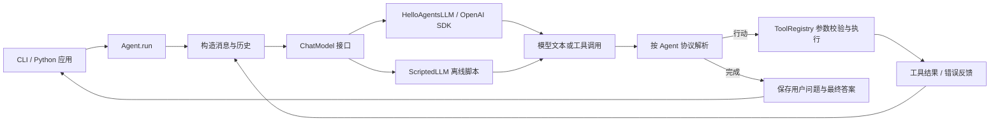

# 第七章到本地实现

这是依据教程分层与协议自行实现的教学框架。Agent 执行循环、解析、历史管理和工具调度均在本地；模型 SDK 负责 HTTP 通信及响应对象转换。它是便于学习和继续扩展的独立实现，公共命名尽量贴近教程，未承诺与上游包的每个版本兼容。

## 章节对应

| 教程章节 | 本地实现 | 观察入口 |
| --- | --- | --- |
| 7.1 架构设计 | `core/`、`agents/`、`tools/` 三层 | 包顶层导出统一接口 |
| 7.2 模型接口 | `core/llm.py` | `invoke()` / `stream()` / `think()` / `complete()` |
| 7.3 框架接口 | `core/message.py`、`config.py`、`agent.py` | `Message`、`Config`、`Agent` |
| 7.4.1 基础对话 | `agents/simple_agent.py` | 多轮、文本工具标记、流式、动态加减工具 |
| 7.4.2 ReAct | `agents/react_agent.py` | Thought → Action → Observation → Finish |
| 7.4.3 反思 | `agents/reflection_agent.py` | initial → reflect → refine |
| 7.4.4 规划执行 | `agents/plan_solve_agent.py` | 计划列表 → 逐步求解 |
| 7.4.5 原生函数调用 | `agents/function_call_agent.py` | assistant.tool_calls → tool.tool_call_id |
| 7.5 工具系统 | `tools/base.py`、`registry.py`、`builtin/` | 类 / 函数注册、参数验证、计算与搜索 |
| 7.5.4 高级工具 | `tools/chain.py`、`async_executor.py` | 模板串联、线程池并发 |

## 组件怎样协作

`ChatModel` 使用 Protocol 描述需要的行为，便于注入离线模型。文本 Agent 使用 `invoke()`；SimpleAgent 流式模式使用 `stream()`；FunctionCallAgent 使用 `complete()` 取得 SDK 消息对象，从而保留调用 ID 和服务返回的附加字段。

库不会在导入时加载环境文件、发起请求或修改日志全局配置。CLI 显式加载 `.env`，创建客户端和注册工具，再运行选定的 Agent。

## 五种执行策略

SimpleAgent 默认执行普通对话。启用工具后，提示模型输出 `[TOOL_CALL:工具名:参数]`，将全部标记解析成功后才执行工具，随后把真实结果反馈给模型。解析器跟踪括号深度及 JSON 双引号，支持数组和字符串中的 `]`。多参数使用 JSON，不使用逗号分割猜测参数。无工具时 `stream_run()` 实时产出文本；有工具时先缓冲整轮，确定是最终答案后再产出，以免把工具协议当成答案显示。

ReActAgent 一轮只接受一个 `Action: 工具名[参数]` 或 `Action: Finish[答案]`。格式错误和工具错误进入 Observation，消耗一次正常的模型调用后允许下一轮修正。`custom_prompt` 可使用 `{tools}`、`{question}`、`{history}`；模板中的其他字面花括号需要用 `{{` 和 `}}` 转义。

ReflectionAgent 先生成初稿，再请求独立审查；有反馈时生成修订稿。只有完整的“无需改进”停止标记才提前结束，不会把“并非无需改进”误认为通过。默认最多两轮反思和修订，模型调用最多 `1 + 2 × max_iterations` 次。可通过 `custom_prompts` 覆盖 `initial`、`reflect`、`refine` 任一阶段，保留其余默认提示词。

PlanAndSolveAgent 先获取字符串列表，可接受 JSON、Python 字面量以及包裹它们的代码围栏。Python 格式用 `ast.literal_eval()` 解析，不执行模型代码。空列表、非字符串步骤、代码或超过 `max_plan_steps` 的计划会抛出 `AgentParseError`。每个执行步骤都能看到完整计划和之前的结果，最后一步直接回答原问题；最多请求模型 `1 + max_plan_steps` 次。`custom_prompts` 支持 `planner` 和 `executor`。

FunctionCallAgent 将工具参数 Schema 直接交给兼容服务。收到原生调用后保留完整 assistant 消息，为每个调用执行工具，并生成带原始 `tool_call_id` 的 tool 消息；一轮多个调用会逐个处理。参数 JSON 无效、未知工具及参数校验失败均作为对应调用的工具错误反馈。收到无工具调用的非空文本才视为完成。

Simple、ReAct、FunctionCall 达到各自的模型调用上限会抛出 `MaxStepsExceeded`；不会再偷偷请求一次模型，也不会把尚待执行的工具标记当成最终答案。Reflection 和 Plan-and-Solve 使用各自的迭代或计划上限，不使用 `Config.max_steps`。

## 历史和轨迹

`get_history()` 返回成功完成的用户问题与最终答案，所有范式都在后续运行中使用这些历史。`get_trace()` 返回本轮的工具输入、观察结果，或生成、审查、修订、执行等阶段输出；ReAct 还提供 `current_history`，Plan-and-Solve 提供 `plan`。两类 getter 都返回副本。

运行失败不会将半轮对话加入持久历史；已发生的工具副作用仍然存在。历史受 `max_history_length` 限制，正常问答裁剪时保留完整问答对。`clear_history()` 清空历史与执行轨迹。历史只保存在内存里，同一 Agent 对象应按顺序调用；当前实现没有会话持久化、并发运行锁或上下文 token 压缩。

## 工具契约

`Tool` 类定义 `run(parameters)`、`get_parameters()` 和 Schema 转换。`FunctionTool` 从同步函数签名生成 Pydantic 参数模型；`ToolRegistry` 负责去重、检索、输入归一化、类型转换和错误包装。直接调用注册表失败会抛出 `ToolError`；Agent 捕获后将错误反馈给模型，工具链则立即停止。

计算器支持有限的数学节点和函数，并限制表达式长度、AST 节点数、指数和中间结果。它不使用 `eval()`；代码导入、属性访问、集合构造等均被拒绝。搜索采用 Tavily 的公开 HTTP 接口，按需读取密钥；演示和测试不会连接搜索服务。本次仅实现一种搜索适配器，可按照相同 Tool 接口继续添加其他来源。

工具链在输入模板中替换 `{input}` 和命名结果，模板或执行失败时停止。并发执行器将同步工具提交给独立线程池，限制同时运行的工作线程数，结果保持输入顺序。默认遇到失败向调用方抛出异常；`return_exceptions=True` 可收集每一项的成功或错误。执行器不是任意代码的隔离沙箱；注册的 Python 函数具有宿主进程的权限。

## 与教程示例的实现选择

保留核心抽象和执行范式，补全教程留给读者实现的反思、规划等方法。配置使用独立实例和 Pydantic v2 校验；不采用共享可变单例。模型 ID 必须由用户指定，避免依赖教程中示例模型的可用性。输出由应用层负责，流式接口不会同时在库内部打印。

本次聚焦第七章：记忆与 RAG、MCP、向量数据库和多智能体通信留待对应章节扩展；后续能力可从 Tool 接口或新的 Agent 子类接入。
